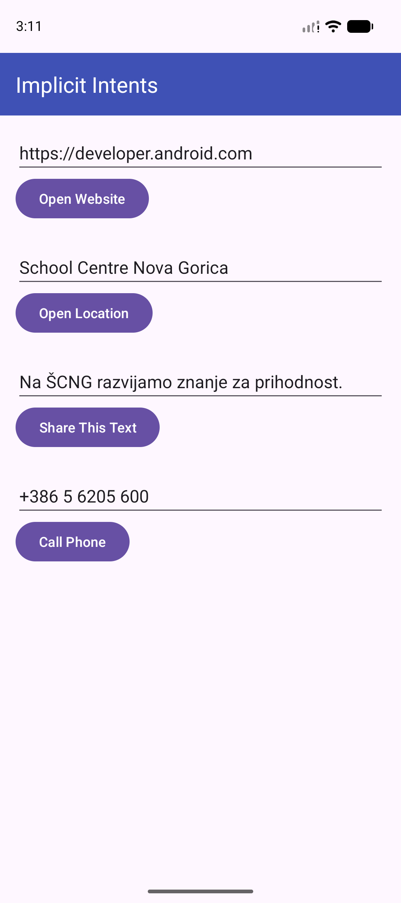
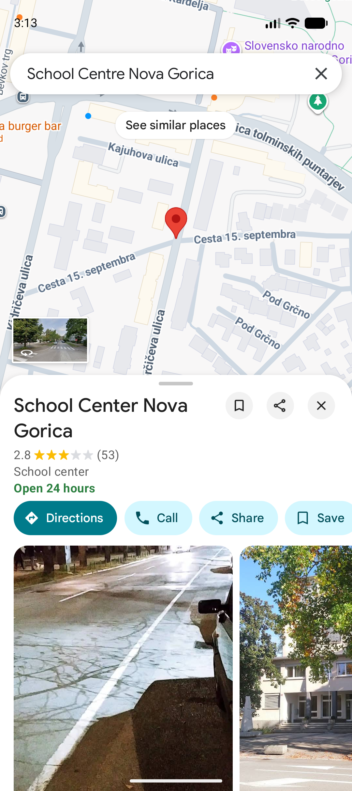

# Naloga 6: Delo z implicitnimi nameni (Implicit Intents)

Mobilna aplikacija za platformo Android, izdelana v okviru predmeta **Razvoj mobilnih aplikacij** (prirejeno po gradivu *Android Developer Fundamentals – Homework 2.3*).

---

## 📱 Opis aplikacije

Aplikacija **ImplicitIntents** prikazuje praktično uporabo **implicitnih namenov** (*Implicit Intents*) v operacijskem sistemu Android. Za razliko od eksplicitnih namenov, kjer neposredno določimo ciljni razred aktivnosti, implicitni nameni določajo le **akcijo** (*action*), ki jo želimo izvesti, ter **podatke** (*data/URI*). Operacijski sistem Android nato sam poišče ustrezno nameščeno aplikacijo ali pa uporabniku prikaže sistemski izbirnik (*app chooser*).

Aplikacija vsebuje štiri pare vnosnih polj (`EditText`) in gumbov (`Button`):
1. **Odpiranje spletne strani (Open Website):**
   - Vnosno polje vsebuje privzeti URL `https://developer.android.com`.
   - Ob kliku na gumb se izvede implicitni namen z akcijo `Intent.ACTION_VIEW` in podatkom `Uri.parse(url)`, ki spletno stran odpre v privzetem brskalniku (npr. Google Chrome).
2. **Prikaz lokacije na zemljevidu (Open Location):**
   - Vnosno polje vsebuje privzeto lokacijo `School Centre Nova Gorica`.
   - Ob kliku na gumb se pripravi geografski URI oblike `geo:0,0?q=iskana_lokacija` ter sproži namen z akcijo `Intent.ACTION_VIEW`, ki lokacijo prikaže na zemljevidu (npr. Google Maps).
3. **Deljenje besedila (Share This Text):**
   - Vnosno polje vsebuje privzeto besedilo `Na ŠCNG razvijamo znanje za prihodnost.`.
   - Ob kliku na gumb se z uporabo knjižničnega razreda `ShareCompat.IntentBuilder` in MIME tipa `text/plain` odpre sistemsko pogovorno okno za deljenje besedila prek različnih nameščenih aplikacij (e-pošta, sporočila, beležke, družbena omrežja).
4. **Klicanje telefonske številke (Call Phone):**
   - Dodatna funkcionalnost za klicanje: vnosno polje vsebuje privzeto telefonsko številko (npr. `+386 5 6205 600`).
   - Telefonska številka se prebere iz vnosnega polja (`mPhoneEditText.getText().toString()`), pretvori v objekt `Uri` z zapisom `Uri.parse("tel:" + phoneNumber)` ter sproži implicitni namen z akcijo `Intent.ACTION_DIAL`, ki odpre klicalnik s pripravljeno številko.

---

## 🔒 Varnost in združljivost (Android 11+ / API 30+)

Za zagotavljanje varnega izvajanja pred klicem `startActivity()` preverimo obstoj primerne aktivnosti s pomočjo metode `resolveActivity(getPackageManager())`.
Zaradi varnostnih omejitev vidnosti paketov (*package visibility*), uvedenih v sistemu Android 11 (API raven 30) in novejših, so v datoteki `AndroidManifest.xml` ustrezno definirani elementi `<queries>`:
- Zahteva za spletne brskalnike (`android.intent.action.VIEW` s shemama `http` in `https` ter kategorijo `BROWSABLE`)
- Zahteva za aplikacije z zemljevidi (`android.intent.action.VIEW` s shemo `geo`)
- Zahteva za telefonski klicalnik (`android.intent.action.DIAL`)
- Zahteva za deljenje besedila (`android.intent.action.SEND` z MIME tipom `text/plain`)

---

## 📸 Zaslonske slike aplikacije

| 1. Glavni zaslon | 2. Odpiranje spletne strani |
| :---: | :---: |
|  |  |
| **3. Prikaz lokacije na zemljevidu** | **4. Klicanje telefonske številke** |
|  |  |

---

## ❓ Odgovori na vprašanja iz učnega lista

### 1. Katera trditev najbolje opiše implicitni namen (implicit Intent)?
> **Odgovor: b. Namen, pri katerem določimo dejanje, ne pa točno določene aktivnosti ali aplikacije, ki ga bo izvedla.**  
> *Obrazložitev:* Pri implicitnih namenih specificiramo le želeno dejanje (akcijo, npr. prikaz podatkov, klic) in podatke (URI), Android sistem pa poišče ustrezno komponento, ki zna to zahtevo obdelati na podlagi svojih filtrov namenov (`intent-filter`).

### 2. Katero akcijo uporabite pri odpiranju spletne strani in pri prikazu lokacije na zemljevidu?
> **Odgovor: c. Intent.ACTION_VIEW**  
> *Obrazložitev:* Akcija `ACTION_VIEW` je standardna splošna akcija za prikaz podatkov uporabniku (bodisi spletnih strani s shemo `http`/`https` bodisi geografskih koordinat s shemo `geo`).

### 3. Kateri zapis pravilno pretvori besedilo lokacije v URI za prikaz na zemljevidu?
> **Odgovor: b. Uri.parse("geo:0,0?q=" + loc)**  
> *Obrazložitev:* Standardna shema URI za geografske lokacije v sistemu Android se začne z `geo:0,0?q=`, kjer za koordinatama `0,0` sledi parameter poizvedbe `q=` z iskanim nizom lokacije.

### 4. Zakaj pred klicem startActivity(intent) uporabite metodo resolveActivity(getPackageManager())?
> **Odgovor: a. Da preverite, ali je na napravi nameščena vsaj ena aktivnost, ki zna obdelati podani implicitni namen.**  
> *Obrazložitev:* Če bi klicali `startActivity()` za namen, za katerega sistem nima nameščene nobene primerne aplikacije, bi prišlo do neujete izjeme `ActivityNotFoundException`, kar povzroči sesutje (crash) aplikacije.

### 5. Kateri MIME tip uporabite pri deljenju besedila?
> **Odgovor: b. text/plain**  
> *Obrazložitev:* MIME tip `text/plain` predstavlja navadno neoblikovano besedilo in omogoča prenos vsem besedilnim aplikacijam.

### 6. Kateri razred poenostavi izdelavo implicitnega namena za deljenje besedila?
> **Odgovor: a. ShareCompat.IntentBuilder**  
> *Obrazložitev:* `ShareCompat.IntentBuilder` je priročen gradnik iz knjižnice AndroidX, ki poenostavi sestavljanje namena `ACTION_SEND` in odpiranje izbirnika aplikacij (`startChooser()`).

### 7. Kateri elementi morajo biti vključeni v intent-filter sprejemne aplikacije, da lahko sprejme povezavo do developer.android.com?
> **Odgovor: a. Akcija VIEW, kategoriji DEFAULT in BROWSABLE ter podatkovni filter s shemo http in gostiteljem developer.android.com.**  
> *Obrazložitev:* Da lahko aplikacija prestreza spletne povezave iz spletnega brskalnika ali drugih programov, mora njen `intent-filter` vsebovati akcijo `VIEW`, obvezni kategoriji `DEFAULT` in `BROWSABLE` ter podatkovno oznako `<data>` s shemo in gostiteljem (`android:host="developer.android.com"`).

### 8. Kako v sprejemni aktivnosti pridobite in prikažete prejeti URI?
> **Odgovor: a. Pridobite vhodni intent z metodo getIntent(), iz njega preberete podatke z metodo getData() in rezultat prikažete v TextView.**  
> *Obrazložitev:* V kodi sprejemne aktivnosti kličemo `Intent intent = getIntent();`, nato podatke pridobimo z `Uri uri = intent.getData();` ter dobljeni naslov z `textView.setText(uri.toString())` izpišemo v gradniku `TextView`.

---

## 🛠️ Zagon in namestitev

### Prevajanje projekta v APK:
```bash
./gradlew assembleDebug
```
Generirana namestitvena datoteka se nahaja na poti:
`app/build/outputs/apk/debug/app-debug.apk`

### Namestitev na priključeno napravo:
```bash
adb install -r app/build/outputs/apk/debug/app-debug.apk
```
