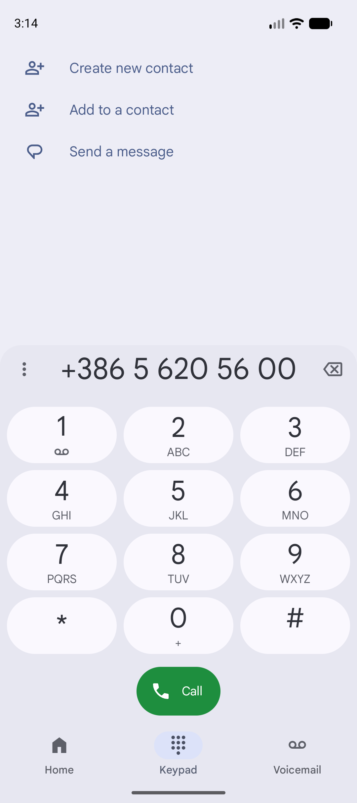

# Naloga 6: Delo z implicitnimi nameni (Implicit Intents)

Mobilna aplikacija za platformo Android, izdelana v okviru predmeta **Razvoj mobilnih aplikacij** (prirejeno po gradivu *Android Developer Fundamentals – Homework 2.3*).

---

## 📱 Opis aplikacije

Aplikacija **ImplicitIntents** prikazuje praktično uporabo **implicitnih namenov** (*Implicit Intents*) v operacijskem sistemu Android. Za razliko od eksplicitnih namenov, kjer neposredno določimo ciljni razred aktivnosti, implicitni nameni določajo le **akcijo** (*action*), ki jo želimo izvesti, ter **podatke** (*data/URI*). Operacijski sistem Android nato sam poišče ustrezno nameščeno aplikacijo ali pa uporabniku prikaže sistemski izbirnik (*app chooser*).

Aplikacija vsebuje štiri pare vnosnih polj (`EditText`) in gumbov (`Button`):
1. **Odpiranje spletne strani (Open Website):**
   - Vnosno polje vsebuje privzeti URL `https://developer.android.com`.
   - Ob kliku na gumb se izvede implicitni namen z akcijo `Intent.ACTION_VIEW` in podatkom `Uri.parse(url)`, ki spletno stran odpre v privzetem brskalniku (npr. Google Chrome).
2. **Prikaz lokacije na zemljevidu (Open Location):**
   - Vnosno polje vsebuje privzeto lokacijo `School Centre Nova Gorica`.
   - Ob kliku na gumb se pripravi geografski URI oblike `geo:0,0?q=iskana_lokacija` ter sproži namen z akcijo `Intent.ACTION_VIEW`, ki lokacijo prikaže na zemljevidu (npr. Google Maps).
3. **Deljenje besedila (Share This Text):**
   - Vnosno polje vsebuje privzeto besedilo `Na ŠCNG razvijamo znanje za prihodnost.`.
   - Ob kliku na gumb se z uporabo knjižničnega razreda `ShareCompat.IntentBuilder` in MIME tipa `text/plain` odpre sistemsko pogovorno okno za deljenje besedila prek različnih nameščenih aplikacij (e-pošta, sporočila, beležke, družbena omrežja).
4. **Klicanje telefonske številke (Call Phone):**
   - Dodatna funkcionalnost za klicanje: vnosno polje vsebuje privzeto telefonsko številko (npr. `+386 5 6205 600`).
   - Telefonska številka se prebere iz vnosnega polja (`mPhoneEditText.getText().toString()`), pretvori v objekt `Uri` z zapisom `Uri.parse("tel:" + phoneNumber)` ter sproži implicitni namen z akcijo `Intent.ACTION_DIAL`, ki odpre klicalnik s pripravljeno številko.

---

## 🔒 Varnost in združljivost (Android 11+ / API 30+)

Za zagotavljanje varnega izvajanja pred klicem `startActivity()` preverimo obstoj primerne aktivnosti s pomočjo metode `resolveActivity(getPackageManager())`.
Zaradi varnostnih omejitev vidnosti paketov (*package visibility*), uvedenih v sistemu Android 11 (API raven 30) in novejših, so v datoteki `AndroidManifest.xml` ustrezno definirani elementi `<queries>`:
- Zahteva za spletne brskalnike (`android.intent.action.VIEW` s shemama `http` in `https` ter kategorijo `BROWSABLE`)
- Zahteva za aplikacije z zemljevidi (`android.intent.action.VIEW` s shemo `geo`)
- Zahteva za telefonski klicalnik (`android.intent.action.DIAL`)
- Zahteva za deljenje besedila (`android.intent.action.SEND` z MIME tipom `text/plain`)

---

## 📸 Zaslonske slike aplikacije

| 1. Glavni zaslon | 2. Odpiranje spletne strani |
| :---: | :---: |
|  |  |
| **3. Prikaz lokacije na zemljevidu** | **4. Klicanje telefonske številke** |
|  |  |
